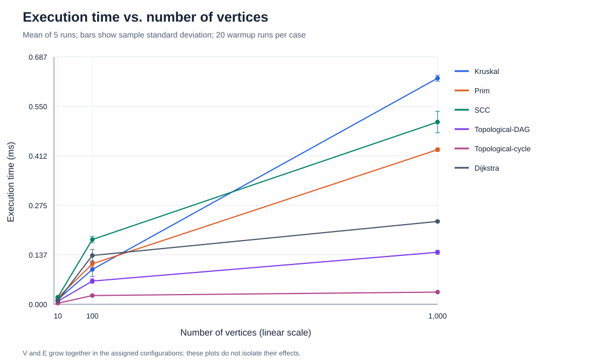
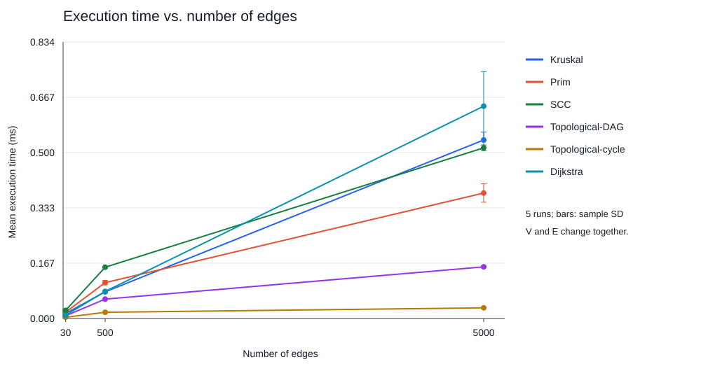

# Assignment 3 — Smart City Infrastructure and Route Planning

## Overview

This Java 17 application represents city districts as vertices `0..V-1` and roads or infrastructure connections as weighted edges. Undirected graphs model construction networks; directed graphs model one-way roads and service dependencies. Edge weights represent one quantity at a time: construction cost for MST or travel distance for routing.

The project implements DSU, Kruskal, Prim, Kosaraju SCC, Kahn topological ordering, and Dijkstra without external Java libraries. It includes an executable city example, correctness tests, fixed-seed experiments, measured CSV tables, and two plots.

### Run and reproduce

Requirements: JDK 17 or later; a POSIX shell for the convenience script. Python 3.9+ is needed only to regenerate plots and this report; both scripts use the standard library.

Run from this project directory:

```sh
sh run.sh test
sh run.sh demo
sh run.sh benchmark
python3 scripts/plot_results.py
python3 scripts/build_report.py
```

The script recompiles all sources with `javac --release 17 -Xlint:all`. Tests throw errors directly and do not require `-ea`. Benchmarks overwrite the measured CSV files; regenerate both plots and the report afterward. The same seed reproduces graphs, algorithm results, and operation counts, but wall-clock timings naturally differ between runs and machines.

The demo reports MST weight **13** for both algorithms, a valid service dependency order, SCCs `{0,1,2}`, `{3,4}`, `{5}`, cycle detection, and distances `[0,4,5,10,12,unreachable]` from district 0. Paths are printed explicitly, including `[0,1,2,3,4]` to district 4.

### Project structure

```text
src/
  graph/           Graph and per-run Metrics
  dsu/             Path-compressed DSU with union by size
  mst/             Kruskal and lazy Prim
  connectivity/    Iterative Kosaraju and Kahn ordering
  shortestpath/    Dijkstra and path reconstruction
  app/             Demo, graph generators, benchmark runner
tests/             Dependency-free correctness suite
results/
  tables/          All 90 raw measurements, 18 summaries, environment
  plots/           SVG time-versus-vertices and time-versus-edges plots
scripts/           Rebuild plots and this report from CSV
run.sh             Compile and run
README.md          Complete report
```

## Implementation

### Graph representation and contracts

`Graph` stores adjacency lists and one logical edge list. An undirected edge is stored once in the logical list and twice in adjacency lists. Thus Kruskal sorts E logical edges, while traversal of every undirected adjacency list examines 2E entries. Parallel edges, repeated weights, self-loops, and isolated vertices are supported. The benchmark generators create simple graphs without self-loops or parallel edges. At least one vertex is required; invalid endpoints are rejected.

Weights use `int`; total MST cost and distances use `long`, preventing overflow when paths or trees contain multiple large `int` weights. Dijkstra's non-negative shortest paths can be chosen simple, so at most V-1 edges are needed; this sum fits `long` for Java's `int`-indexed graph. `Long.MAX_VALUE` represents unreachable distance. Graph algorithms allocate fresh state and do not mutate the input graph. Returned edge, ordering, component, and path lists are immutable.

### DSU and infrastructure planning

DSU provides `find` and `union`. `find` first walks to the root and then compresses the path iteratively. `union` attaches the smaller component below the larger component. A failed union means that both vertices already have the same representative.

Kruskal sorts edges by weight, with endpoints as deterministic tie breakers, and accepts an edge only when DSU merges different components. It stops once one component remains. Accepted edges cannot form a cycle. By the cut property, each accepted lightest eligible edge is safe for a minimum spanning forest.

Prim uses a Java `PriorityQueue` binary heap of crossing edges. Each accepted edge reaches an unseen vertex. Outdated entries pointing to seen vertices are discarded. This is **lazy Prim**, so the heap may contain O(E) edges; it is not an indexed decrease-key implementation. When a component finishes, the outer loop starts the next unseen vertex. Both algorithms return a minimum spanning forest, its total weight, and the number of components. A spanning tree exists exactly when `components == 1`. Different MST edge sets are valid when weights tie, so comparison uses total weight and structural validity rather than requiring identical edges.

### Directed connectivity

Kahn's algorithm computes indegrees, queues every zero-indegree vertex, and removes outgoing edges as vertices are processed. The graph is a DAG exactly when V vertices are processed. A cyclic graph returns `acyclic=false` and an empty order, avoiding presentation of a partial order as a valid answer.

Kosaraju first obtains DFS finishing order, constructs the transpose, then visits the transpose in reverse finishing order. Each traversal produces one SCC. Both passes use explicit stacks, avoiding recursion overflow on long chains. The first pass stores a neighbor cursor for each vertex so that finishing times match recursive DFS. Every vertex is assigned once; correctness tests additionally check mutual reachability, not only partition coverage.

### Shortest paths

Dijkstra validates all logical edge weights, initializes the source to zero, and uses a binary heap ordered by tentative distance and vertex identifier. An improved distance inserts a new heap entry. An entry whose stored distance differs from the current best value is stale and skipped. Predecessors reconstruct a source-to-destination path; unreachable vertices return `INF` and an empty path. The source returns distance 0 and the singleton path `[source]`. Strict improvements prevent predecessor cycles even with zero-weight cycles.

Dijkstra's greedy argument relies on non-negative weights: extending a path cannot reduce its distance. For example, with edges `s→a=2`, `s→b=5`, `b→a=-10`, settling `a` at distance 2 is incorrect; the actual shortest distance is -5. A lazy implementation that permits later improvements may revisit vertices, but it then lacks Dijkstra's usual correctness/runtime guarantee and can fail to terminate with a reachable negative cycle. This implementation rejects negative edges anywhere in the graph, including unreachable components. Bellman–Ford is appropriate when negative edges are allowed, with explicit handling of reachable negative cycles.

## Complexity Analysis

V is the number of vertices and E the number of logical edges. The graph representation uses O(V+E) space. The table describes additional algorithm storage, including returned results. `log(E+1)` avoids an undefined logarithm for edgeless graphs.

| Algorithm | Time | Additional space | Assumptions and explanation |
| --- | --- | --- | --- |
| DSU initialization | O(V) | O(V) | Parent and size arrays |
| DSU find / union | O(α(V)) amortized per operation | O(1) per call | Combined compression and union by size; O(log V) worst case for a single operation; α is inverse Ackermann |
| Kruskal | O(V + E log(E+1) + E α(V)) | O(V+E) | Edge copying/sorting, DSU, and forest result; typically written O(E log E) for a connected nontrivial graph |
| Lazy Prim | O(V + E log(E+1)) | O(V+E) | Binary heap can contain O(E) edges; all undirected adjacency entries are scanned |
| Kosaraju SCC | O(V+E) | O(V+E) | Two DFS passes plus transpose construction; explicit stacks and component output |
| Kahn topological ordering | O(V+E) | O(V) | Indegrees, FIFO queue, order; same worst-case bound for cycle detection |
| Lazy Dijkstra | O(V + E + (E+1) log(E+1)) | O(V+E) | Full negative-weight validation plus duplicate-entry binary heap; at most E successful relaxations |
| Reconstruct one shortest path | O(V) worst case | O(V) | Walk predecessors and reverse; unreachable path O(1) |

For simple graphs, E ≤ V², so the heap-based bounds can also be expressed using log V (for example O((V+E) log V) when V ≥ 2). The more explicit log E form reflects the implementations and also covers parallel edges. No O(V)-heap decrease-key bound is claimed.

More vertices increase initialization, traversal state, and output costs. More edges increase scans, sorting, and heap work. For sparse graphs with E proportional to V, SCC and topological ordering are linear in V, while sorting/heap methods are generally O(V log V). For dense simple graphs, E can grow quadratically; edge work dominates. Increasing V alone does not necessarily increase heap work if most vertices remain isolated.

Union by size bounds depth because whenever a vertex's depth increases, its containing component at least doubles. Compression shortens later root searches. Together they make repeated DSU operations nearly constant amortized time. Without either optimization, a poor sequence can produce linear-height trees. The experiment counts DSU calls and parent traversals in Kruskal, but does not measure an unoptimized baseline; no empirical optimization speedup is claimed.

## Experimental Setup

| Size | V | E | Seed |
| --- | --- | --- | --- |
| Small | 10 | 30 | 202613 |
| Medium | 100 | 500 | 202703 |
| Large | 1,000 | 5,000 | 203603 |

All generators use `java.util.Random`, with seed `202603 + V`, and weights uniformly drawn from integers 1..100. Endpoint rejection sampling ensures distinct edges and the exact requested edge count. Repeated weights are allowed.

- **Undirected/MST:** first connect each vertex v>0 to a random earlier vertex, forming a spanning tree; add unique random unordered pairs until E edges exist. Connectivity is guaranteed. Kruskal and Prim receive the identical graph object for a given size. This planted-tree method is reproducible but is not a uniform sample of all connected graphs.
- **DAG/topological:** only add edges u→v where u<v. Increasing vertex labels provide a valid underlying topological order, so cycles cannot occur.
- **Cyclic/SCC and topological:** plant 0→1 and 1→0, then add arbitrary unique directed edges. A cycle is guaranteed, but strong connectivity of the whole graph is not imposed.
- **Directed routing:** add arbitrary unique ordered pairs. Cycles and unreachable vertices are possible, not guaranteed. Dijkstra starts at district 0.

Graph generation and preflight MST/cycle checks occur outside timing. Each algorithm/input pair receives 20 untimed warmup calls followed by exactly **5 measured calls**, each bracketed with `System.nanoTime()`. The same graph is reused; every call allocates fresh algorithm state and counters. Negative-weight validation, sorting, transpose construction, and algorithm output construction are included in the corresponding measured call. Source-to-every-vertex path reconstruction, console output, CSV writing, plotting, and input generation are excluded. A volatile result sink retains each result after the timed interval.

Reported means are arithmetic means. Sample standard deviation uses denominator 4. Raw observations, min, max, and standard deviation are retained. Counters are deterministic and checked for equality across the five repetitions, so the operation table reports per-run counts (also equal to their averages).

### Counter definitions

- **Edge examinations:** one logical-edge validation/scan or one adjacency entry visited. Kruskal counts candidate edges considered after sorting; its sorting work is represented by comparator calls. Prim counts 2E adjacency entries. Kosaraju counts E for each DFS pass plus E for building the transpose (3E total). Kahn counts E for indegree construction plus outgoing edges of processed vertices. Dijkstra counts E for validation plus reachable adjacency entries scanned.
- **Comparator calls:** one invocation of the edge-sort or priority-queue comparator, including an invocation that resolves ties. This is not the number of primitive integer comparisons.
- **find / union calls:** DSU method invocations; each union invokes find twice. **Parent hops** count parent-link traversal in both the root-search and compression passes.
- **Offers / polls:** insertions/removals in an algorithm's priority queue or Kahn FIFO queue. DFS stack operations are not counted as queue operations.

These counters describe selected work, not all CPU operations. In particular, it would be misleading to add heterogeneous counters into a single performance score or equate an edge scan with a heap comparison.

### Recorded environment

```text
Recorded at: 2026-10-21T13:17:48.793527Z
Java: 17.0.17
VM: OpenJDK 64-Bit Server VM
OS: Mac OS X 26.1
Architecture: aarch64
Processors available: 8
Warmups: 20 per graph/algorithm; measured repetitions: 5
```

## Results

### Execution times

| Algorithm / input | V | E | Mean (ms) | Sample SD (ms) | Min (ms) | Max (ms) |
| --- | --- | --- | --- | --- | --- | --- |
| Kruskal | 10 | 30 | 0.013233 | 0.003579 | 0.010792 | 0.019500 |
| Prim | 10 | 30 | 0.017967 | 0.001491 | 0.016333 | 0.019125 |
| SCC | 10 | 30 | 0.019675 | 0.002739 | 0.015541 | 0.022375 |
| Topological-DAG | 10 | 30 | 0.008450 | 0.001930 | 0.007209 | 0.011875 |
| Topological-cycle | 10 | 30 | 0.002958 | 0.000485 | 0.002542 | 0.003541 |
| Dijkstra | 10 | 30 | 0.010016 | 0.001165 | 0.008417 | 0.011541 |
| Kruskal | 100 | 500 | 0.096825 | 0.020171 | 0.070917 | 0.121917 |
| Prim | 100 | 500 | 0.112417 | 0.008238 | 0.104000 | 0.121958 |
| SCC | 100 | 500 | 0.179933 | 0.008892 | 0.173333 | 0.193167 |
| Topological-DAG | 100 | 500 | 0.064558 | 0.006267 | 0.060666 | 0.075667 |
| Topological-cycle | 100 | 500 | 0.024308 | 0.001927 | 0.022708 | 0.027333 |
| Dijkstra | 100 | 500 | 0.135658 | 0.016788 | 0.127208 | 0.165667 |
| Kruskal | 1000 | 5000 | 0.628208 | 0.008302 | 0.618417 | 0.637208 |
| Prim | 1000 | 5000 | 0.429608 | 0.004603 | 0.425042 | 0.435208 |
| SCC | 1000 | 5000 | 0.506392 | 0.029941 | 0.459708 | 0.541041 |
| Topological-DAG | 1000 | 5000 | 0.144500 | 0.005585 | 0.139042 | 0.153083 |
| Topological-cycle | 1000 | 5000 | 0.033909 | 0.001086 | 0.033167 | 0.035750 |
| Dijkstra | 1000 | 5000 | 0.230217 | 0.002495 | 0.228375 | 0.234541 |

### Operation counts per run

| Algorithm / input | V | Edge examinations | Comparator calls | find calls | Parent hops | union calls | Offers | Polls |
| --- | --- | --- | --- | --- | --- | --- | --- | --- |
| Kruskal | 10 | 9 | 112 | 18 | 10 | 9 | 0 | 0 |
| Prim | 10 | 60 | 199 | 0 | 0 | 0 | 30 | 30 |
| SCC | 10 | 90 | 0 | 0 | 0 | 0 | 0 | 0 |
| Topological-DAG | 10 | 60 | 0 | 0 | 0 | 0 | 10 | 10 |
| Topological-cycle | 10 | 30 | 0 | 0 | 0 | 0 | 0 | 0 |
| Dijkstra | 10 | 60 | 46 | 0 | 0 | 0 | 14 | 14 |
| Kruskal | 100 | 182 | 3818 | 364 | 594 | 182 | 0 | 0 |
| Prim | 100 | 1000 | 7664 | 0 | 0 | 0 | 500 | 500 |
| SCC | 100 | 1500 | 0 | 0 | 0 | 0 | 0 | 0 |
| Topological-DAG | 100 | 1000 | 0 | 0 | 0 | 0 | 100 | 100 |
| Topological-cycle | 100 | 500 | 0 | 0 | 0 | 0 | 0 | 0 |
| Dijkstra | 100 | 1000 | 1363 | 0 | 0 | 0 | 137 | 137 |
| Kruskal | 1000 | 3317 | 55214 | 6634 | 12192 | 3317 | 0 | 0 |
| Prim | 1000 | 10000 | 112192 | 0 | 0 | 0 | 5000 | 5000 |
| SCC | 1000 | 15000 | 0 | 0 | 0 | 0 | 0 | 0 |
| Topological-DAG | 1000 | 10000 | 0 | 0 | 0 | 0 | 1000 | 1000 |
| Topological-cycle | 1000 | 5036 | 0 | 0 | 0 | 0 | 8 | 8 |
| Dijkstra | 1000 | 9968 | 24539 | 0 | 0 | 0 | 1456 | 1456 |

The complete machine-readable data is in [raw.csv](results/tables/raw.csv) and [summary.csv](results/tables/summary.csv).

### Required plots





Both plots use linear axes and sample-standard-deviation bars. The two plots use the same three paired (V,E) configurations, so they do not independently establish how V and E affect runtime. Lines connect measured observations and do not imply that intermediate sizes were measured.

## Comparison and Discussion

### Kruskal versus Prim

Measured mean-time ratios are **V=10: Kruskal/Prim = 0.74; V=100: Kruskal/Prim = 0.86; V=1000: Kruskal/Prim = 1.46**. A ratio below 1 favors Kruskal; above 1 favors Prim. These ratios describe this run and these implementations, not a universal winner.

Kruskal sorts every logical edge but can stop its DSU scan once V-1 edges have been accepted. At V=1,000, it examines 3,317 candidates, invokes the sort comparator 55,214 times, and makes 6,634 find calls. Prim scans 10,000 adjacency entries, offers/polls 5,000 heap entries, and makes 112,192 heap comparator calls. Prim's lazy heap processes outdated edges; Kruskal spends work sorting edges even if it never considers them for its tree.

In the recorded run, timing does not follow comparator counts proportionally. Comparator cost, collection operations, allocations, cache behavior, JIT compilation, and instrumentation differ. Equal total MST weight and forest invariants establish correctness; a smaller runtime does not establish it. Kruskal is convenient when edges are already available as a list; Prim naturally uses adjacency lists and can benefit from other heap designs, which were not tested here.

### SCC scaling

SCC examines exactly 90, 1,500, and 15,000 edges across the sizes: 3E, matching the two passes and transpose construction. Its mean runtime grows by **25.74×** from small to large while V+E grows from 40 to 6,000 (150×). The discrepancy does not refute O(V+E): asymptotic complexity is not an exact runtime ratio, and small fixed overheads and JVM optimization affect these short measurements. The counter trend is the clearer evidence of linear edge work. More vertices also increase initialization, stack processing, and component-list work.

### Topological ordering on DAGs and cycles

For DAGs, every vertex is processed and exactly 2E edges are examined. Cyclic graphs may leave most vertices unprocessed because none have indegree zero. The small and medium cyclic inputs process zero vertices after the initial E-edge scan; the large cyclic input processes eight vertices and examines 5,036 edges overall. Thus detecting these cycles is faster than producing a complete DAG order in this run, without changing the O(V+E) worst-case bound. The empty-order result correctly communicates failure.

### Dijkstra scaling and reachability

Dijkstra's mean runtime grows by **22.98×** from small to large. Heap comparator calls grow from 46 to 1,363 to 24,539; offers/polls grow from 14 to 137 to 1,456. Stale heap entries explain why polls can exceed V. The large graph examines 9,968 edges: 5,000 in weight validation and 4,968 during reachable adjacency scans. Some adjacency entries are outside the source-reachable region; therefore the routing workload depends on reachability as well as V and E. A single source and one graph per size do not characterize all possible road networks.

### Limits of the experiment

The required five repetitions provide a small sample, not a reliable distribution estimate. There is one JVM process, a fixed algorithm order, no separate process forks, and no control of scheduling, CPU frequency, garbage collection, or background activity. Twenty warmups reduce startup effects but do not guarantee steady-state compilation. Counter instrumentation itself adds cost. The measurements are suitable for this reproducible coursework comparison, not for broad performance claims. A stronger future study would use multiple graph seeds, independent density sweeps, randomized order, more repetitions, and a dedicated JVM benchmark harness. These extensions are not represented as completed experiments.

## Testing

`sh run.sh test` passes **63,561 checks**, including the following:

| Requirement / risk | Test and oracle |
| --- | --- |
| Small known graph | Demo MST total 13; explicitly constructed unit cases check weights and components |
| Disconnected graphs | Edgeless four-vertex graph and two-component weighted graph; both algorithms return valid forests |
| Cycles | Directed two-cycle, mixed cyclic/acyclic components, and self-loop; no valid order returned |
| Multiple MSTs and duplicate weights | Equal-weight four-vertex cycle plus diagonal; both MST totals are 3 |
| Unreachable vertices | Directed and undirected graphs with isolated vertices; INF and empty paths |
| Single vertex | MST, topology, SCC, and source-to-source shortest path |
| Zero/negative weights | Zero-weight paths and cycles; negative MST edges allowed; Dijkstra rejects even unreachable negative edges |
| Parallel edges and self-loops | MST ignores loop; shortest paths use the cheaper parallel edge |
| Large numeric totals | Two maximum-int weights sum to 4,294,967,294 using long |
| MST independent optimality | 30 seeded six-vertex graphs, exhaustive enumeration of all V-1 edge subsets |
| MST structural correctness | Chosen-edge weight sum, edge count V-components, no cycle, component count |
| Dijkstra independent distances | Floyd–Warshall for every source in 30 seeded directed graphs and explicit cases |
| Path correctness | Endpoints, existing edges, no repeated vertices, reconstructed total equals reported distance |
| SCC correctness | Every vertex occurs once; same component iff mutual reachability holds according to independent all-pairs computation |
| DAG validity | Every vertex appears once; every edge points forward in the returned order |
| DSU | Repeated unions, merged representatives, and flattened path after compression |
| Deep traversal | 20,000-vertex chain verifies iterative SCC and topological processing |
| Input contracts | Reject invalid endpoints, empty graph, wrong directedness, invalid source |
| Reproducibility | Regenerated seeded edge lists match; benchmark counters match all five repeats |

Randomized checks supplement the algorithm arguments; they do not prove correctness for every possible input. Tests use their own assertions, so disabling Java assertions cannot silently skip them. Benchmarks independently verify MST weight agreement and expected DAG/cycle status before measurement.

## Conclusion

Use Kruskal or Prim to minimize total infrastructure construction cost; on disconnected input, report a forest rather than claiming a spanning tree. Use SCC to identify mutually reachable districts in a directed network. Use topological ordering for acyclic service dependencies and report failure if a cycle prevents scheduling. Use Dijkstra for source-to-district shortest routes with non-negative distances, including explicit unreachable results and reconstructed paths.

The operation counts agree with the implementations' predicted scan, sort, and heap behavior. Runtime measurements show that constants and JVM effects matter at these graph sizes, so the evidence supports task-specific algorithm selection rather than a universal fastest algorithm.

## Submission and rubric checklist

| Criterion | Points | Evidence |
| --- | --- | --- |
| DSU | 10 | `src/dsu/DSU.java`; compression, union by size, operation counters and tests |
| Kruskal and Prim | 20 | `src/mst/MinimumSpanningTree.java`; total cost, components, identical-input comparisons |
| SCC and topological ordering | 15 | `src/connectivity/Connectivity.java`; iterative Kosaraju, Kahn and cycle tests |
| Dijkstra | 15 | `src/shortestpath/Dijkstra.java`; paths, unreachable vertices, weight validation |
| Complexity analysis | 10 | Implementation-specific time/space table and V/E discussion |
| Experimental design | 10 | Exact sizes, fixed seeds, 20 warmups, five measurements, nanoTime and counters |
| Results and discussion | 10 | Raw and summarized CSVs, both plots, measured interpretation and limitations |
| Testing | 5 | Deterministic edge cases and independent randomized oracles |
| README and GitHub quality | 5 | Complete report, organized source tree, meaningful Git history and GitHub repository |
| **Total available** | **100** | Coverage checklist, not a guaranteed grade |

### Repository

Repository: [whoisaii/assignment-3](https://github.com/whoisaii/assignment-3).

Clone and verify:

```sh
git clone https://github.com/whoisaii/assignment-3.git
cd assignment-3
sh run.sh test
sh run.sh demo
```

Use the repository URL for submission. The source code, measured CSV data, plots, and full report are versioned together.

